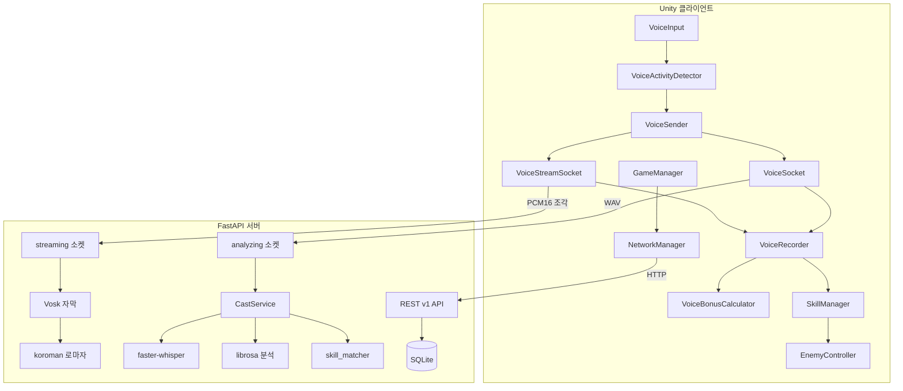
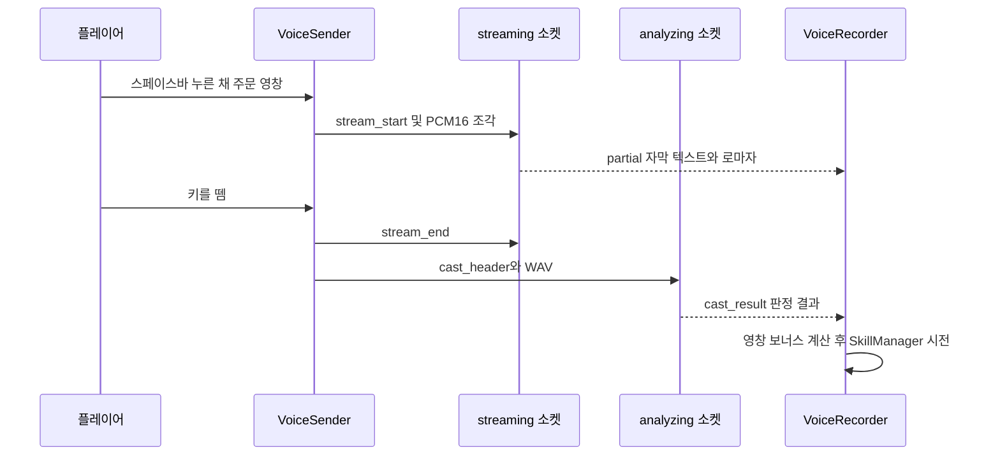

# ai-STT-castingspell-game

> 목소리로 주문을 외워 마법을 시전하는 한국어 음성 인식 기반 3D 마법 RPG
> Unity 클라이언트 + FastAPI 음성 판정 서버 (faster-whisper · Vosk · librosa)

---

## 프로젝트 소개

이 프로젝트는 키보드나 마우스 대신 **플레이어가 실제로 소리 내어 외친 주문(한국어 문장)** 을 인식해 마법을 시전하는 1인칭 3D 마법 RPG입니다. 플레이어가 스페이스바를 누른 채(기본값) 주문을 말하면 Unity 클라이언트가 마이크 음성을 WAV로 만들어 서버로 보내고, 서버는 음성을 텍스트로 받아쓴 뒤 현재 사용 가능한 스펠 목록과 비교해 어떤 마법인지 판정합니다.

스펠은 `활활`, `주륵주륵`, `꽃이 피었어요`, `아이스 아메리카노 주세요`처럼 의성어·의태어나 일상 표현으로 이루어져 있습니다. 노말·불·물·풀 4개 속성에 걸쳐 총 30개이며, 몬스터를 처치해 얻은 두루마리로 하나씩 해금합니다. 판정 결과에는 받아쓴 텍스트뿐 아니라 **성량(dB)과 피치(Hz)** 분석값이 함께 담기고, 클라이언트는 이 값을 플레이어의 평소 목소리와 비교해 "더 크고 높게 외친 주문"에 데미지 보너스를 줍니다.

게임은 `TitleScene → GameScene(스테이지 1) → BossScene(스테이지 2, 마왕전) → EndingScene` 흐름으로 구성되어 있습니다. 말하는 동안에는 서버가 보내는 중간 받아쓰기 결과가 실시간 자막(발음 로마자)으로 표시됩니다.

저장소는 Unity 프로젝트(`Client`), 게임 서버 및 음성 판정 서버(`Server`), 초기 음성 판정 프로토타입(`AI/Pipeline_v2`)으로 나뉩니다.

## 문제 정의

음성 명령 게임은 "말한 대로 반응한다"는 경험이 핵심이지만, 범용 음성 인식 모델을 그대로 게임에 붙이면 다음 문제가 생깁니다. 아래는 코드와 주석에서 확인되는 문제 의식입니다.

- **잡음·무음에서의 환각**: Whisper는 작은 소리나 무음에도 그럴듯한 문장을 만들어 내며, 재시도(temperature fallback)까지 겹치면 판정이 크게 지연될 수 있습니다. (`Server/services/stt.py` 주석)
- **비슷한 주문의 오발동**: 인식 결과가 철자나 띄어쓰기에서 조금씩 달라지므로, 정확히 일치하는 문자열 비교로는 판정하기 어렵고 이름이 비슷한 스펠끼리 혼동될 수 있습니다. (`Server/services/skill_matcher.py`)
- **피드백 지연**: 최종 판정은 발화가 끝난 뒤에야 가능하므로, 말하는 동안 아무 반응이 없으면 플레이어는 입력이 들어가고 있는지 알기 어렵습니다. (`/ws/voice/streaming`, `VoiceStreamSocket.cs`)
- **게임 상태와 비동기 판정의 충돌**: 판정을 기다리는 동안 적이 쓰러지거나 다음 주문을 말하기 시작할 수 있어, 늦게 도착한 결과를 어떻게 처리할지 정해야 합니다. (`VoiceSender.cs`, `VoiceRecorder.cs`)

## 주요 기능

### 음성 입력 및 판정
- **두 가지 입력 방식**: 키를 누르는 동안 녹음하는 Push-to-Talk(기본 Space)와, 음량 기반 VAD가 말의 시작과 끝을 자동으로 감지하는 AutoDetect를 Inspector에서 선택할 수 있습니다. (`Voice/VoiceSender.cs`, `Voice/VoiceActivityDetector.cs`)
- **서버 음성 판정**: WAV 디코딩 → faster-whisper 받아쓰기 → librosa 음향 분석 → 자모 유사도 기반 스펠 매칭 순서로 처리하며, 결과를 `cast_result` JSON으로 반환합니다. (`Server/services/cast_service.py`)
- **불발 사유 구분**: `EMPTY`, `NOISE`, `NO_MATCH`, `AMBIGUOUS` 등 실패 원인을 구분해 응답에 담습니다. 입력 길이 초과나 잘못된 WAV는 `error`로 처리합니다.
- **실시간 자막**: 말하는 동안 0.1초 단위 PCM 조각을 별도 WebSocket으로 보내면, 서버가 Vosk로 중간 받아쓰기를 하고 koroman으로 발음 로마자를 만들어 돌려줍니다. (`Server/services/partial_vosk.py`, `Server/services/romanize.py`)
- **동적 스펠 목록**: 클라이언트가 해금 상태가 바뀔 때마다 `skill_list`를 보내면, 서버는 이 목록을 Whisper 힌트(initial prompt)와 매칭 대상으로 사용하고 이름이 비슷한 스펠 쌍을 경고로 돌려줍니다.
- **영창 보너스**: 성량이 평소보다 +6dB 이상이면 강한 영창(×1.25), 여기에 피치까지 +2반음 이상이면 완벽한 영창(×1.5)으로 판정합니다. (`Battle/VoiceBonusCalculator.cs`)

### 게임플레이
- **속성 상성 전투**: 물 → 불, 불 → 풀, 풀 → 물 상성에서 우위이면 데미지 1.5배가 적용됩니다. 데미지는 `baseDamage × 영창 보너스 × 상성 배율`로 계산합니다. (`Battle/EnemyController.cs`)
- **스펠 시전 연출 4종**: Projectile, TargetInstant, WandCharge, Beam 방식이 있으며 `SpellData` ScriptableObject에서 지정합니다. (`Data/SpellData.cs`, `Manager/SkillManager.cs`)
- **스테이지 1**: 몬스터가 다수로 등장하는 디펜스 게임입니다. 몬스터를 일정 수 처치하면 랜덤 속성의 스펠 두루마리가 드랍되고, 이를 획득하면 스펠이 해금됩니다. 10마리마다 휴식 지점(체력 회복)이 있고, 50마리를 처치하면 보스전으로 넘어갑니다. (`Stage1/`, `Manager/GameSessionManager.cs`, `Battle/DropItem.cs`)
- **보스전(스테이지 2)**: 내 턴(제한 시간 안에 주문 1회)과 보스 턴이 번갈아 진행됩니다. 체력에 따라 페이즈 1→2→3으로 넘어가며 보스 속성이 바뀝니다. 페이즈 2부터 하수인이 등장하고, 상성 공격을 2연속 적중시키면 보스가 기절합니다. (`BossScene/BossBattleDirector.cs`, `BossScene/BossController.cs`)
- **도감 UI**: 해금한 스펠을 속성과 단계별로 보여 주는 스펠 도감과, 처치 기록을 보여 주는 몬스터 도감이 있습니다. (`UI/SpellBookUI.cs`, `UI/MonsterBookUI.cs`)
- **게임 오버 및 엔딩 연출**: 슬로 모션과 3인칭 카메라 전환을 거쳐 결과 패널을 띄우고, 엔딩에서는 문구와 크레딧이 순서대로 나옵니다. (`General/GameOverSequence.cs`, `EndingScene/EndingSceneController.cs`)
- **설정**: 마이크 장치, 해상도, 볼륨을 선택할 수 있고, 서버 세션이 있으면 설정값을 서버에 동기화합니다. (`Manager/GameSettingManager.cs`, `UI/MicDropdown.cs`, `UI/ResolutionDropdown.cs`)

### 게임 서버 (REST)
- 세션 생성, 저장, 종료 및 환경설정 조회·변경 API를 제공합니다. 데이터는 SQLite에 저장합니다. (`Server/main.py`, `Server/models.py`)
- 서버 측 스펠 자동 해금(`check_and_unlock_spells`)과 `/v1/spells` API가 구현되어 있지만, `Spell` 테이블의 초기 데이터 입력 코드가 없어 **실제 사용 여부는 확인 필요**합니다. 현재 게임 내 해금은 클라이언트의 `SkillManager`가 관리합니다.

## 기술 스택

| 구분 | 기술 | 근거 |
|---|---|---|
| 게임 엔진 | Unity 6 (6000.3.10f1), URP 17.3.0 | `Client/ProjectSettings/ProjectVersion.txt`, `Packages/manifest.json` |
| 클라이언트 언어 | C# | `Client/Assets/Scripts` |
| 클라이언트 라이브러리 | NativeWebSocket, Newtonsoft Json(SnakeCase 매핑), TextMeshPro, Input System, AI Navigation, Timeline, ProBuilder, glTFast | `Packages/manifest.json` (glTFast, ProBuilder 등은 의존성 기준 확인) |
| 서버 언어 | Python 3.11+ | `Server/requirements.txt` 주석 |
| 웹 프레임워크 | FastAPI 0.143, Uvicorn, websockets, Pydantic 2 | `Server/requirements.txt` |
| 데이터베이스 | SQLite + SQLAlchemy 2.1 | `Server/database.py` |
| 음성 인식 (최종 판정) | faster-whisper 1.2.1 (Whisper small, CPU int8) | `Server/services/stt.py` |
| 음성 인식 (실시간 자막) | Vosk 0.3.45 (`vosk-model-small-ko-0.22`) | `Server/services/partial_vosk.py` |
| 음향 분석 | librosa (RMS, YIN 피치), NumPy, SciPy, soundfile | `Server/services/audio_analysis.py` |
| 한글 로마자 변환 | koroman 1.0.16 | `Server/services/romanize.py` |
| 에셋 관리 | Git LFS (`*.asset`, `*.png`, `*.wav`, `*.fbx` 등) | `.gitattributes` |

## 아키텍처 및 구조

### 전체 구성



- `VoiceInput`, `VoiceActivityDetector`, `VoiceSender`: `Client/Assets/Scripts/Voice/`에 있으며, 마이크 입력 → 말 구간 감지 → WAV 생성 및 전송을 담당합니다.
- `VoiceStreamSocket`, `VoiceSocket`: 같은 폴더에 있으며, 각각 `/ws/voice/streaming`과 `/ws/voice/analyzing`에 연결합니다. 씬에 설정된 주소는 `ws://127.0.0.1:8000/...`입니다.
- `VoiceRecorder`, `VoiceBonusCalculator`, `EnemyController`: `Client/Assets/Scripts/Battle/`에 있으며, 판정 결과 표시, 영창 보너스 계산, 데미지 처리를 담당합니다.
- `SkillManager`, `GameManager`, `NetworkManager`: `Client/Assets/Scripts/Manager/`에 있습니다.
- `streaming 소켓`, `analyzing 소켓`: `Server/routers/websocket.py`에 있습니다.
- `CastService`, `faster-whisper`, `librosa 분석`, `skill_matcher`, `Vosk 자막`, `koroman 로마자`: `Server/services/` 아래의 각 모듈입니다.
- `REST v1 API`, `SQLite`: `Server/main.py`, `Server/database.py`, `Server/models.py`에 있습니다.

### 발화 하나의 처리 흐름



`VoiceSender.cs`의 클래스 주석과 `routers/websocket.py`의 프로토콜 주석을 근거로 작성했습니다. 실시간 자막 요청과 최종 판정 요청은 **같은 `request_id`** 를 사용합니다.

### 구조 설명

**클라이언트 음성 계층**은 역할별로 컴포넌트를 나누었습니다. `VoiceInput`은 마이크 샘플을 10ms 단위로 내보내는 역할만 하고, `VoiceActivityDetector`는 Unity 컴포넌트가 아닌 일반 C# 클래스(30ms 프레임, RMS dB, 상태 기계)로 작성해 파일 입력으로도 반복 시험할 수 있게 했습니다. `VoiceSender`는 녹음 방식, 전송, 결과 대기를 조정합니다. 게임 로직을 직접 참조하지 않고 `CanAccept` 함수와 이벤트로만 게임과 연결되어, 음성 모듈과 전투 모듈 사이의 결합도를 낮추었습니다.

**서버 음성 계층**은 `voice_runtime`이 Whisper와 Vosk 모델을 서버 시작 시 한 번만 불러와 공유합니다. 최종 판정(`/analyzing`)은 Whisper가 맡고, 실시간 자막(`/streaming`)은 Vosk가 맡도록 엔진을 분리했습니다. Whisper는 처음부터 다시 받아쓰는 방식이라 반복 호출 비용이 크지만, Vosk는 새로 들어온 소리만 이어서 처리하는 스트리밍 방식입니다. 실시간 자막 엔진은 `PARTIAL_ENGINE` 값으로 `vosk`, `whisper`, `off` 중에서 바꿀 수 있습니다.

**게임 서버 계층**은 FastAPI REST API와 SQLite로 세션, 저장 데이터, 환경설정을 관리합니다. 모든 요청은 `access-token` 헤더로 검증하고, 세션별 요청은 `session-id` 헤더로 구분합니다. 응답은 `status/code/message/data` 형식으로 통일했고, 예외도 공통 핸들러에서 같은 형식으로 반환합니다. (`Server/handlers.py`, `Server/exceptions.py`)

`AI/Pipeline_v2`는 FastAPI로 통합하기 전의 **독립 실행형 판정 프로토타입**입니다. `websockets` 기반 서버(포트 8765), 점검용 클라이언트, 녹음 스크립트로 구성되어 있으며, 이후 `Server/services/`로 옮겨지며 확장된 것으로 보입니다. (커밋 기록 기준 추정, 확인 필요)

## 핵심 구현 포인트

### 1. 자모 단위 유사도와 2단계 게이트로 스펠 판정
`skill_matcher.py`는 인식 텍스트와 스펠 이름을 정규화(공백·기호 제거, 앞에 붙은 간투사 `어/아/음` 제거)한 뒤, 유니코드 NFD로 **초성·중성·종성을 분해하여** `SequenceMatcher`로 비교합니다. 음절 단위보다 세밀하게 비교하므로 한두 자모가 틀린 오인식도 점수로 반영할 수 있습니다. 1위 점수가 `MATCH_THRESHOLD(0.50)` 미만이면 `NO_MATCH`, 1위와 2위의 점수 차가 `AMBIGUITY_GAP(0.15)` 미만이면 `AMBIGUOUS`로 처리해 **애매하면 시전하지 않는** 쪽을 택했습니다. 스펠 목록을 받을 때는 `find_collisions()`로 비슷한 이름 쌍을 찾아 클라이언트에 경고를 보냅니다.

### 2. Whisper를 게임용 짧은 명령 인식기로 조정
`stt.py`에서는 후보가 정해진 짧은 발화라는 점을 활용해 다음과 같이 설정했습니다.
- `beam_size=1`, `temperature=0.0`(재시도 끔), `condition_on_previous_text=False`
- 현재 스펠 이름 목록을 `initial_prompt`로 넘겨 스펠 어휘 쪽으로 디코딩을 유도
- **생성 길이 자동 제한**: 스펠 이름 중 가장 긴 것의 토큰 수 × 2 + 8을 `max_new_tokens`로 지정(16~96 범위)하고, 같은 목록이면 캐시를 재사용
- `no_speech` 확률이 0.6을 넘으면 `NOISE`로 버려 잡음에 대한 환각을 차단

응답에 `tokens`와 `token_limit`을 함께 담아, 생성 토큰이 상한에 닿은 경우를 "지어낸 글자일 가능성"으로 판단할 수 있게 했습니다.

### 3. 두 개의 WebSocket과 순서가 보장되는 전송 대기열
최종 판정(`/analyzing`, WAV 한 덩어리)과 실시간 자막(`/streaming`, PCM16 조각)을 **별도의 연결로 분리하고 같은 `request_id`로 묶었습니다.** 코드 주석에 따르면 NativeWebSocket은 텍스트와 바이너리의 전송 대기열이 따로 있어 메시지 순서가 섞일 수 있습니다. 그래서 `VoiceStreamSocket`은 모든 메시지를 단일 대기열에 넣어 하나씩 보내고, `VoiceSocket`은 `SemaphoreSlim`으로 `cast_header` → WAV 사이에 `skill_list`가 끼어들지 않게 막습니다.

### 4. 서버 동시성 제어: 최종 판정 우선
CPU에서 Whisper 모델 하나를 여러 스레드가 동시에 쓰면 경합이 심하므로, `asyncio.Semaphore(1)`로 동시 판정 수를 제한하고 동기 추론은 `asyncio.to_thread`로 이벤트 루프 밖에서 실행합니다. `pending_finals` 카운터로 대기 중인 최종 판정이 있으면 Whisper 중간 자막을 새로 시작하지 않습니다. Vosk 쪽은 발화마다 처리 루프를 하나만 돌려 인식기를 여러 스레드에서 동시에 쓰지 않게 했습니다. 또 조각이 2초 이상 끊긴 발화는 watchdog이 정리합니다. (`routers/websocket.py`, `services/voice_runtime.py`)

### 5. 비동기 판정과 게임 상태의 정합성
- **막기 방식**: 판정을 기다리는 동안 들어온 새 발화는 보관하지 않고 버립니다. 시간 초과로 포기한 요청 번호는 `expiredRequests`에 기록해 두었다가, 늦게 도착한 결과를 자막·시전·벌칙에 쓰지 않습니다. (`VoiceSender.cs`)
- **데미지 예약**: 마법이 시전되는 순간 `EnemyController.ReserveDamage()`로 "날아가는 중인 데미지"를 미리 더해 둡니다. 이미 쓰러질 예정인 적에게는 영창을 받지 않아, 연출 시간 동안 낭비되는 주문을 막습니다.
- **무음 차단**: 녹음 전체의 최대 진폭이 기준보다 작으면 판정을 보내지 않고, 자막 스트림도 `stream_end` 대신 `stream_cancel`로 정리합니다.

## 트러블슈팅 및 기술적 고민

아래 항목은 **코드 주석과 커밋 메시지에서 확인되는 내용**만 정리했습니다. 실제 증상 수치와 해결 전후 비교는 추가 입력이 필요합니다.

| 문제 | 원인 (코드 근거) | 대응 |
|---|---|---|
| 작은 소리나 무음에서 판정이 20초 이상 지연됨 | faster-whisper 기본 temperature fallback이 최대 6번까지 다시 받아쓰며 긴 문장을 지어냄 (`stt.py` 주석) | `TEMPERATURE=0.0`, `max_new_tokens` 자동 제한, `no_speech` 게이트, 클라이언트 무음 차단 |
| 잡음을 스펠로 오인 | Whisper가 잡음에도 텍스트를 생성하고, `initial_prompt` 때문에 스펠명으로 편향될 수 있음 (`skill_matcher.py`, `cast_service.py` 주석) | `MAX_NO_SPEECH_PROB`, `MATCH_THRESHOLD`, `AMBIGUITY_GAP` 게이트 |
| Vosk 모델 로드 실패 시 서버 전체 종료 위험 | vosk가 모델을 찾지 못하면 `sys.exit(1)`을 호출 (`partial_vosk.py` 주석) | `SystemExit`까지 잡고 실시간 자막만 끈 채 판정은 정상 동작 |
| 조각마다 리샘플링하면 경계에 잡음 발생 | 조각 단위 `resample_poly` (`stream_session.py` 주석) | 모아 둔 소리 전체를 다시 변환한 뒤 새 부분만 잘라내고, 끝부분 0.05초는 보류 |
| WebSocket 메시지 순서가 뒤섞임 | NativeWebSocket의 텍스트·바이너리 대기열 분리 (`VoiceStreamSocket.cs` 주석) | 단일 송신 대기열, 전송 잠금 |
| librosa 첫 호출 지연 | 모듈 로딩과 numba 컴파일 (`cast_service.py` 주석) | 서버 시작 시 사인파로 미리 실행(warm-up) |
| Windows 환경 인코딩 문제 | 커밋 "인코딩 오류 수정", `requirements.txt`의 "ASCII-only" 주석(cp949) | 파일 인코딩 정리, requirements는 ASCII로 유지 |

> **추가 입력 필요**: 아래 질문에 답하면 이 섹션을 경험 중심으로 보강할 수 있습니다.
> - 무음 지연 문제는 어떤 상황에서 처음 발견했고, 개선 전후 처리 시간은 어떻게 측정했나요?
> - 한 음절 스펠(예: 이전 스펠 목록)에서 오발동이 있었다면, 그것이 현재처럼 문장형 스펠 이름을 택한 이유였나요?
> - 실시간 자막 엔진을 Whisper에서 Vosk로 바꾼 결정의 근거는 무엇이었나요?

## 설치 및 실행 방법

### 사전 요구 사항
- Git LFS (모델, 텍스처, 사운드, `.asset` 파일이 LFS로 관리됨)
- Unity 6000.3.10f1
- Python 3.11 이상
- 최초 실행 시 인터넷 연결 (Whisper small, Vosk 한국어 모델 자동 다운로드)

### 1. 저장소 클론
```bash
git lfs install
git clone https://github.com/SwuriSwuri-sswu/ai-STT-castingspell-game.git
```

### 2. 서버 실행 (Windows 기준, `requirements.txt` 주석 참고)
```bash
cd Server
py -3.11 -m venv .venv
.venv\Scripts\pip install -r requirements.txt
.venv\Scripts\python main.py
```
- `main.py`가 Uvicorn을 `0.0.0.0:8000`, `reload=True`로 실행합니다.
- 서버를 시작하면 Whisper → Vosk 순서로 모델을 불러오고, 로딩 시간을 로그로 출력합니다.
- SQLite 파일(`game.db`)은 실행 경로에 자동으로 생성됩니다.
- conda를 쓰는 경우: `conda create -n castingspell-server python=3.11` → `conda activate castingspell-server` → `pip install -r requirements.txt`

**환경 변수**

| 이름 | 설명 | 기본값 |
|---|---|---|
| `GAME_TOKEN` | REST API `access-token` 헤더 검증 값 | `valid_token` (클라이언트 `NetworkManager`의 기본값과 같음) |

### 3. 클라이언트 실행
1. Unity Hub에서 `Client` 폴더를 프로젝트로 엽니다.
2. `Assets/Scenes/TitleScene.unity`를 열고 Play합니다. (빌드 설정의 시작 씬은 확인 필요)
3. 서버 주소는 씬의 `VoiceSocket`, `VoiceStreamSocket`, `NetworkManager` 컴포넌트에 `127.0.0.1:8000`으로 설정되어 있습니다.

### (선택) 음성 판정 프로토타입 단독 실행
```bash
cd AI/Pipeline_v2
pip install -r requirements.txt
python ws_server.py            # ws://localhost:8765
python ws_test.py a.wav        # 녹음 파일 판정 결과 확인
python record_wav.py test.wav  # 2초 녹음 (sounddevice 필요)
```

### (선택) 스킬명 충돌 검사
```bash
cd Server/services
python skill_matcher.py
```

## 폴더 구조

```text
ai-STT-castingspell-game/
├── Client/                         # Unity 6 프로젝트 (URP)
│   └── Assets/
│       ├── Scenes/                 # Title, Game(스테이지 1), Boss, Ending, Test, simul
│       ├── Scripts/
│       │   ├── Voice/              # 마이크 입력, VAD, WebSocket 전송, 프로토콜 DTO, 디버그 도구
│       │   ├── Battle/             # 판정 결과 처리, 영창 보너스, 적, 플레이어 체력, 드랍
│       │   ├── Manager/            # SkillManager, GameManager, NetworkManager, 세션 기록, 설정
│       │   ├── Stage1/             # 스테이지 1 진행, 몬스터 스폰, 인트로
│       │   ├── BossScene/          # 보스전 진행, 보스 AI, 보스 HUD
│       │   ├── Data/               # SpellData 등 ScriptableObject, 수집 기록
│       │   ├── UI/                 # 스펠 도감, 몬스터 도감, 설정 드롭다운
│       │   └── TitleScene/ EndingScene/ General/ Editor/
│       ├── Spells/                 # 스펠 에셋 (Normal, Fire, Water, Grass × Tier 1~3)
│       └── Prefabs/ Animations/ Sounds/ Resources/
├── Server/                         # FastAPI 게임 서버 + 음성 판정 서버
│   ├── main.py                     # 앱 진입점, REST API, 인증
│   ├── routers/websocket.py        # /ws/voice/streaming, /ws/voice/analyzing
│   ├── services/                   # STT, Vosk, 음향 분석, 스킬 매칭, 스트림 세션, 로마자
│   ├── models.py / schemas.py      # SQLAlchemy 모델, Pydantic 스키마
│   └── database.py / handlers.py / exceptions.py
└── AI/Pipeline_v2/                 # 독립 실행형 음성 판정 프로토타입 및 점검 스크립트
```

## 배운 점

- **음성 인식 모델을 서비스 요구에 맞게 조정하기**: 범용 STT 모델을 그대로 쓰지 않고, 후보 어휘 힌트, 생성 길이 제한, 재시도 끄기, 무음 게이트를 조합해 짧은 명령어 인식에 맞추는 과정을 경험했습니다.
- **한국어 텍스트 처리**: 자모 분해(NFD) 기반 유사도, 띄어쓰기 정규화, 간투사 제거, 발음 규칙을 반영한 로마자 변환 등 한국어 특성을 고려한 비교 방식을 다루었습니다.
- **실시간 오디오 파이프라인**: 마이크 링 버퍼 읽기, VAD 상태 기계와 프리롤, PCM16/WAV 변환, 샘플레이트 변환처럼 오디오 데이터의 흐름을 직접 구현했습니다.
- **비동기 서버 설계**: FastAPI WebSocket, `asyncio.to_thread`, 세마포어를 이용한 CPU 바운드 추론의 동시성 제어와 요청 우선순위 설계를 다루었습니다.
- **클라이언트-서버 프로토콜 설계**: `request_id`로 두 연결의 메시지를 묶고, 버전 필드, 오류 코드, 늦은 응답 폐기 규칙을 정의했습니다.
- **Unity 게임 구조**: ScriptableObject 기반 데이터 정의, 이벤트 기반 컴포넌트 분리, 씬 전환과 싱글턴 매니저 관리, Git LFS를 이용한 에셋 협업을 경험했습니다.

<!-- 본인이 실제로 담당한 영역 위주로 취사선택하세요: 추가 입력 필요 -->

## 향후 개선 사항

- **자동화 테스트 추가**: 현재 자동화 테스트 코드는 확인되지 않습니다. `skill_matcher`, `audio_analysis`, `stream_session`에 대한 pytest 단위 테스트와, Unity Test Framework 기반 VAD 테스트를 추가할 수 있습니다.
- **판정 품질 지표 정리**: 스펠별 정답률, 오발동률, 처리 시간을 기록하는 평가 스크립트와 결과 문서를 마련할 수 있습니다.
- **설정 외부화**: 서버 주소, 토큰, 모델 크기, 임계값 등 코드와 씬에 고정된 값을 설정 파일이나 환경 변수로 옮길 수 있습니다.
- **서버 측 스펠 데이터 연동**: `Spell` 테이블 초기 데이터와 `/v1/spells`를 실제 해금 흐름에 연결하거나, 사용하지 않는다면 정리할 수 있습니다.
- **보안 강화**: CORS 전체 허용(`*`)과 고정 기본 토큰을 배포 환경에 맞게 제한할 수 있습니다.
- **조사·명령어 허용 매칭**: "돌을 쏴"처럼 문장 속에 섞인 스펠 이름을 인식하려면 부분 구간 탐색이 필요합니다. (`skill_matcher.py` 상단 주석)
- **GPU 추론 옵션**: `stt.py` 주석에 있는 `large-v3`, `cuda`, `float16` 설정을 실험할 수 있습니다.
- **배포 및 빌드 자동화**: 서버 컨테이너화(Dockerfile)와 클라이언트 빌드 및 CI 파이프라인을 추가할 수 있습니다.
